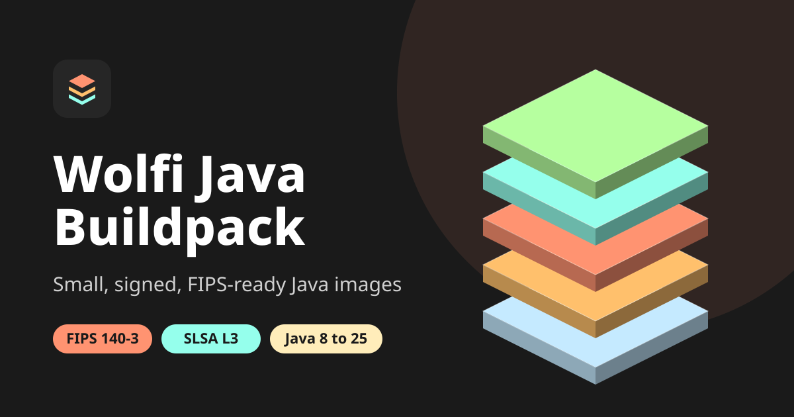

<p align="center">
  
</p>

<p align="center">
  <a href="https://github.com/taha2samy-3/java_buildpack_wolfi/actions/workflows/ci.yml"></a>
  <a href="https://slsa.dev/spec/v1.0/levels#build-l3"></a>
  <a href="https://scorecard.dev/viewer/?uri=github.com/taha2samy-3/java_buildpack_wolfi"></a>
  <a href="LICENSE"></a>
</p>

# Wolfi Java Buildpack

A [Cloud Native Buildpack](https://buildpacks.io) that turns Java source code or JARs into minimal, signed, non-root container images on [Wolfi](https://github.com/wolfi-dev), with an optional FIPS 140-3 mode backed by the CMVP validated Bouncy Castle FIPS module.

**Documentation: https://taha2samy-3.github.io/java_buildpack_wolfi/**

```sh
pack build my-app --builder ghcr.io/taha2samy-3/wolfi-java-builder:latest
pack build my-app --builder ghcr.io/taha2samy-3/wolfi-java-builder:latest --env BP_JVM_FIPS_ENABLED=true
```

## Features

- Eclipse Temurin JDK and JRE for every LTS release (8, 11, 17, 21, 25), amd64 and arm64, pinned by SHA-256.
- Optional FIPS 140-3 mode: Bouncy Castle FIPS Java API 2.1.1 (CMVP #4943) in approved-only mode, BCJSSE, a BCFKS truststore and a build-time self-test that fails the build if the configuration is wrong.
- Container-aware memory sizing at launch, with `calculated`, `percentage` (75% by default) and `off` modes.
- Distroless Wolfi run image: glibc, no shell, no package manager, non-root user `1001`, read-only root filesystem friendly.
- Runtime switches for JMX, JDWP, JFR, NMT and heap dumps, bound to loopback by default.
- Custom CA certificates through `ca-certificates` service bindings at build or launch time.
- Air-gapped builds through `BP_DEPENDENCY_MIRROR` and `dependency-mapping` bindings.
- SLSA Build Level 3 provenance, keyless Sigstore signatures and CycloneDX SBOM attestations for every release image.

## Images

| Image | Description |
| --- | --- |
| `ghcr.io/taha2samy-3/wolfi-java-builder` | Builder for `pack build` |
| `ghcr.io/taha2samy-3/wolfi-java-buildpack` | Composite Java buildpack |
| `ghcr.io/taha2samy-3/wolfi-jvm-buildpack` | JVM buildpack (`taha2samy-3/wolfi-jvm`) |
| `ghcr.io/taha2samy-3/wolfi-build` | Build image |
| `ghcr.io/taha2samy-3/wolfi-run` | Distroless run image |

## Configuration

The full, generated list lives in the [configuration guide](https://taha2samy-3.github.io/java_buildpack_wolfi/configuration). The most common variables:

| Variable | Default | Description |
| --- | --- | --- |
| `BP_JVM_VERSION` | `21` | Java major version |
| `BP_JVM_TYPE` | `JRE` | `JRE` or `JDK` in the final image |
| `BP_JVM_FIPS_ENABLED` | `false` | Enable FIPS 140-3 mode |
| `BPL_JVM_MEMORY_MODE` | `calculated` | `calculated`, `percentage` or `off` |
| `BPL_JVM_HEAP_PERCENTAGE` | `75` | Heap share in `percentage` mode |
| `BPL_JVM_HEAD_ROOM` | `10` | Memory kept free in `calculated` mode |

## Verify a release

```sh
slsa-verifier verify-image ghcr.io/taha2samy-3/wolfi-java-builder@sha256:<digest> \
  --source-uri github.com/taha2samy-3/java_buildpack_wolfi --source-tag v<version>
```

Each release note contains the digests and the full `cosign` commands.

## Development

Requirements: Go, Docker, [pack](https://buildpacks.io/docs/for-platform-operators/how-to/integrate-ci/pack/), [Task](https://taskfile.dev) and Node.js 22 for the documentation site.

```sh
task check          # gofmt, vet, unit tests
task builder        # stack images, buildpacks and builder for the local architecture
task integration    # build and run the sample applications against the local builder
task update-deps    # refresh pinned Temurin releases
```

Documentation site:

```sh
go run ./cmd/site data --offline
cd site && npm ci && npm run dev
```

See [CONTRIBUTING.md](CONTRIBUTING.md) and [SECURITY.md](SECURITY.md).

## Trademarks

Java and OpenJDK are trademarks or registered trademarks of Oracle and/or its affiliates. Eclipse Temurin and Adoptium are trademarks of the Eclipse Foundation. Bouncy Castle is a trademark of its respective owner. Wolfi is a project of Chainguard. Paketo is a Cloud Foundry Foundation project. This project is independent and not affiliated with or endorsed by any of them.

## License

[Apache-2.0](LICENSE)
